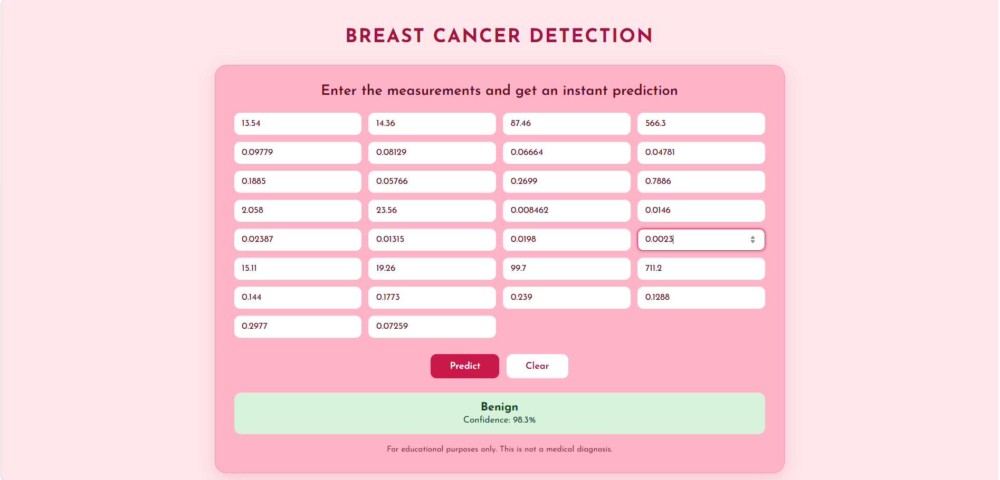

# Breast Cancer Classification

A simple web app that predicts whether a breast tumor is **benign** or **malignant** from 30 cell nucleus measurements. The interface is built with HTML, CSS and JavaScript, and talks to a machine learning model served by a Flask API.


> **Disclaimer:** this project is for educational purposes only. It is not a medical diagnosis tool.

## Features

- Clean, responsive form with the 30 input measurements
- Instant prediction (benign / malignant) with a confidence score
- Python (Flask) API that loads a trained scikit-learn model
- Input validation on both the browser and the server side

## How it works

```
HTML form  ->  JavaScript (fetch)  ->  Flask API  ->  ML model  ->  JSON response  ->  result displayed
```

## Tech stack

- **Frontend:** HTML, CSS, JavaScript
- **Backend:** Python, Flask, Flask-CORS
- **Machine learning:** scikit-learn, NumPy, joblib

## Dataset

[Breast Cancer Wisconsin (Diagnostic)](https://scikit-learn.org/stable/modules/generated/sklearn.datasets.load_breast_cancer.html), available in scikit-learn: 569 samples, 30 numeric features (mean, error and worst values of 10 cell nucleus characteristics), 2 classes (`0` = malignant, `1` = benign).

## Project structure

```
Breast-Cancer-classification/
├── index.html     # User interface
├── style.css      # Styles
├── app.py         # Flask API
├── model.pkl      # Trained model
└── README.md
```
## Model performance

| Metric | Score |
|--------|-------|
| Accuracy | 94% |

